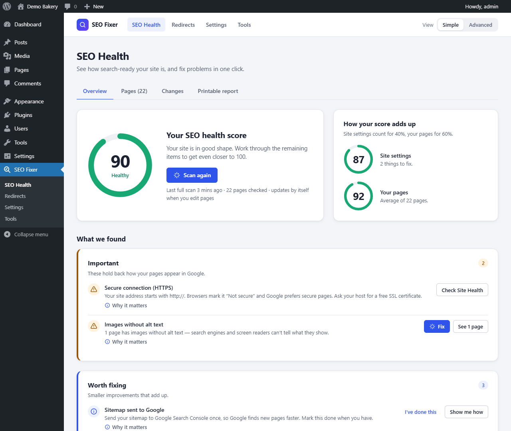
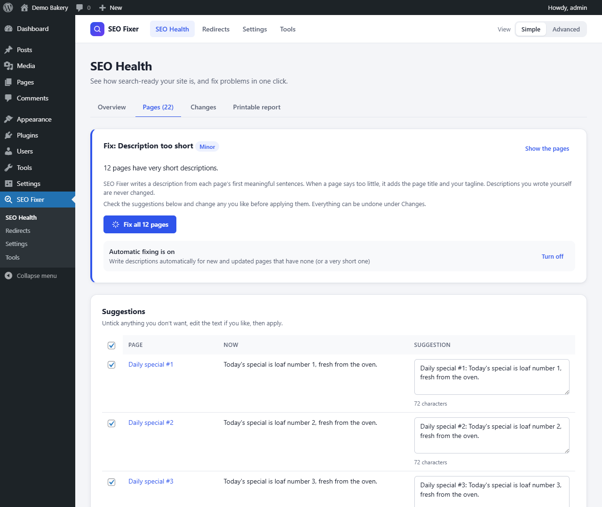
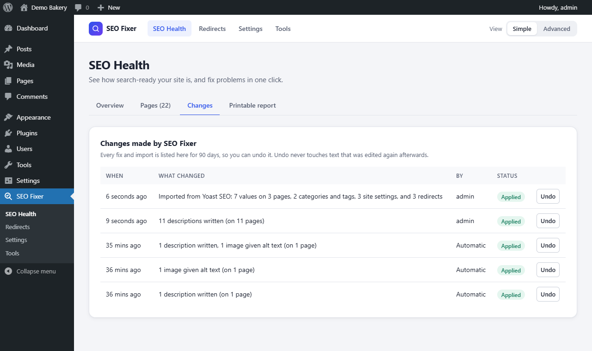

# SEO Fixer

A WordPress SEO plugin for people who aren't SEO experts. It scans the site, gives a health score from 0 to 100, explains each problem in plain English, and fixes most of them with one click. Every fix can be undone.

## Why I built it

Most of the client sites I work on already have Yoast or Rank Math, and the owners still don't know what's wrong with their pages. They see 40 settings screens and a red dot. I wanted something that just says "these 3 pages have no description, here's one written from the page's own text, click to apply".

## What it does

- **Scans every page:** long or duplicate titles, missing or duplicate meta descriptions, images without alt text or too large, broken internal links, orphan pages, thin content, pages hidden from search.
- **Site checks:** "Discourage search engines" left on, HTTP / mixed content, robots.txt blocking the site, no site icon, 404s people keep hitting.
- **One-click fixes** with preview, edit, apply, "Fix all", and a full change log with undo. It never overwrites text the owner wrote.
- **The usual SEO features:** title and meta templates, XML sitemaps with images, robots.txt editor, canonical and noindex controls, schema (Organization, LocalBusiness, Article, Product, FAQ, breadcrumbs), Open Graph and X cards, redirects (301/302/307/410, regex, CSV), a 404 log, and IndexNow.
- **Import** from Yoast, Rank Math, AIOSEO, SEOPress and The SEO Framework, with a preview first and undo after.
- **Private:** no external calls by default, and no CSS or JS added to the front end.

## Technical notes

- Plain PHP, no framework. Class autoloader, with code split by area under `includes/` (scanner, fixes, meta, schema, redirects, import, indexing).
- **Big sites:** the scan runs in small batches in the background, with a lock so two scans can't overlap. Pages are rechecked on `save_post`. Tested with 5,000 pages.
- **Security:** capability checks and nonces on every action, with input sanitised on the way in and escaped on the way out (`includes/class-security.php`, `class-sanitize.php`).
- **Conflicts:** if another SEO plugin is active, SEO Fixer stops printing its own tags, so pages never get duplicate meta (`class-conflicts.php`).
- **Editor:** a block editor sidebar and a classic editor meta box with a live checklist.
- Translation ready (`languages/`), RTL supported, and keyboard and screen-reader friendly.

Requires WordPress 6.4+ and PHP 7.4+.

## Install

Download the repo as a ZIP, then go to **Plugins → Add New → Upload Plugin** and activate it. Then open **SEO Fixer → SEO Health → Scan my site**.

## Screenshots

| | |
|---|---|
|  |  |

## License

GPL-2.0-or-later
